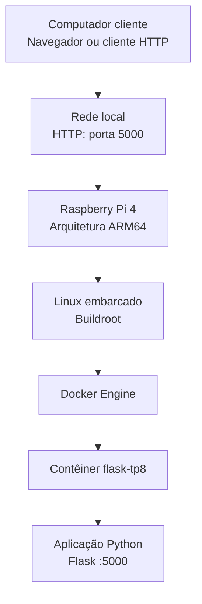

# 01 — Arquitetura do Sistema

## 1. Objetivo

Este documento apresenta a arquitetura do TP-Aula08, desenvolvido com Buildroot, Docker e Flask para a plataforma Raspberry Pi 4.

A solução tem como objetivo gerar uma imagem Linux embarcada que incorpore o Docker Engine e permita executar uma aplicação web Flask em um contêiner, com inicialização automatizada dos componentes.

## 2. Componentes da arquitetura

### 2.1. Computador cliente

É o equipamento utilizado para acessar a aplicação web por meio de um navegador ou de uma ferramenta HTTP. O acesso previsto ocorre pela rede, utilizando o endereço IP do Raspberry Pi 4 e a porta 5000.

### 2.2. Raspberry Pi 4

É a plataforma de hardware definida como alvo do projeto. O sistema Linux gerado pelo Buildroot foi configurado para essa plataforma, utilizando a arquitetura de 64 bits.

### 2.3. Linux embarcado com Buildroot

O Buildroot é utilizado para configurar e construir o sistema Linux destinado ao Raspberry Pi 4.

A imagem incorpora os componentes e arquivos necessários à execução do Docker e à integração da aplicação. A árvore externa do projeto mantém as configurações específicas do TP-Aula08 separadas do código original do Buildroot.

### 2.4. Docker Engine

O Docker Engine é o componente responsável pela execução dos contêineres no sistema Linux.

A configuração do projeto prevê que o serviço Docker esteja disponível durante a inicialização e que a imagem da aplicação possa ser carregada a partir de um arquivo TAR incorporado ao sistema de arquivos.

### 2.5. Contêiner Flask

O contêiner utiliza a imagem `flask-tp8:1.0`, construída para a arquitetura ARM64.

Dentro dele, a aplicação Flask disponibiliza uma resposta HTTP pela porta 5000. A configuração do contêiner publica essa porta para permitir o acesso externo à aplicação.

## 3. Fluxo de funcionamento

O fluxo previsto para o sistema é:

1. O Raspberry Pi 4 é ligado.
2. O Linux embarcado inicializa.
3. O Docker Engine é iniciado.
4. O script `S99docker-flask` aguarda a disponibilidade do Docker.
5. A imagem da aplicação é carregada, caso ainda não esteja disponível localmente.
6. O contêiner Flask é iniciado.
7. Um computador cliente acessa a aplicação pela rede usando a porta 5000.

Esse fluxo representa o funcionamento projetado. A inicialização completa precisa ser confirmada por meio de testes no hardware-alvo.

## 4. Diagrama da arquitetura

## 5. Comunicação de rede

A aplicação é disponibilizada pela porta 5000 do sistema hospedeiro, por meio do mapeamento de portas configurado no Docker.

O endereço utilizado pelo cliente segue o formato:

`http://IP_DO_RASPBERRY:5000`

O endereço IP real depende da configuração de rede do Raspberry Pi 4. Ele deve ser obtido durante a inicialização do sistema no hardware ou no ambiente em que estiver sendo executado.

## 6. Organização da configuração

Os principais elementos do projeto relacionados à arquitetura são:

- `br2-external/`: configurações específicas do projeto para o Buildroot.
- `br2-external/board/rpi4/overlay/`: arquivos incorporados ao sistema de arquivos.
- `br2-external/board/rpi4/overlay/etc/init.d/S99docker-flask`: script de inicialização do contêiner.
- `br2-external/board/rpi4/overlay/opt/docker/`: imagem Docker exportada em formato TAR.
- `flask-app/`: código-fonte e arquivos de construção da aplicação Flask.

## 7. Estado da validação

A imagem Docker ARM64 e a resposta da aplicação foram verificadas no ambiente de desenvolvimento. A imagem Linux foi gerada com o Buildroot.
